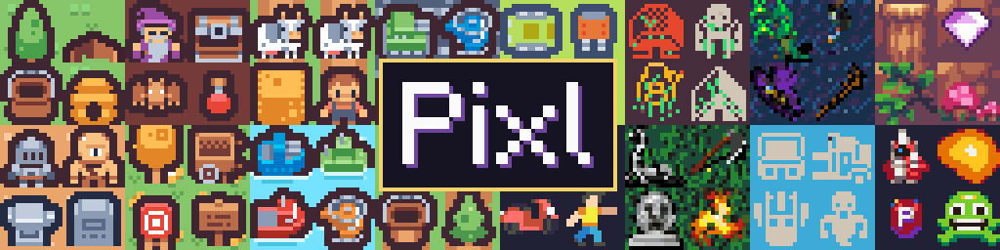
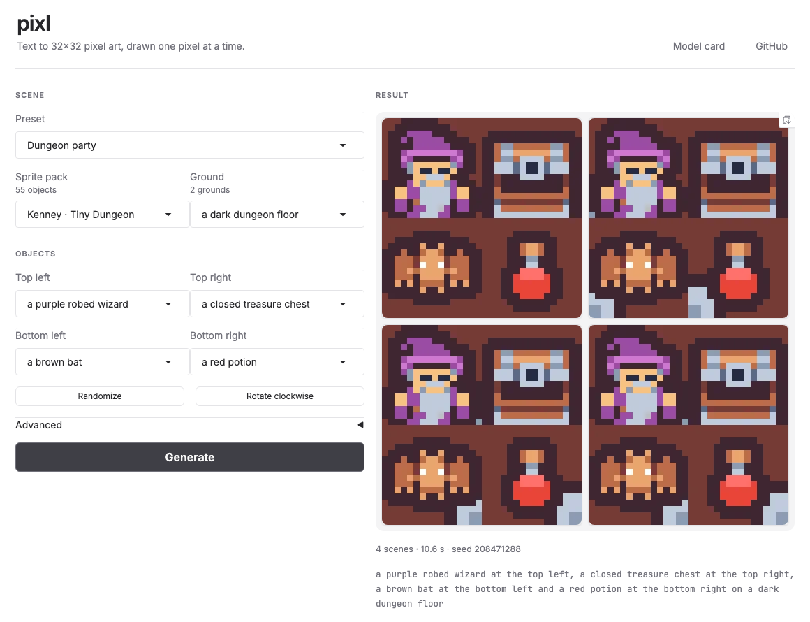

*16 scenes drawn by pixl from their captions, in one batch: seed 0, temperature 0.7, top-k 32, guidance 3.*

# pixl

> 🙏 **Thanks to [@harshitruwali](https://github.com/harshitruwali) for the GPU compute used to train pixl.**

Pixl is a text-to-pixel-art model. It draws a 32×32 image one pixel at a time from a caption, with an encoder-decoder Transformer trained from scratch. It learns from a million generated scenes, each with four sprites in the four quadrants of the image and a caption that says which sprite is where.

## Draw a scene

The trained model is on the Hugging Face Hub as [`ocdbytes/pixl`](https://huggingface.co/ocdbytes/pixl). Install the package, then load it with `load_pretrained()`:

```bash
pip install git+https://github.com/ocdbytes/PIXL
```

```python
import torch
from PIL import Image

from pixl.model import encode_captions
from pixl.preprocess import decode, load_palette
from pixl.tokenizer import Tokenizer
from pixl.train import load_pretrained

model = load_pretrained()  # load_pretrained(bf16=True) downloads the half-size copy
torch.manual_seed(0)
caption = ("a purple robed wizard at the top left, a closed treasure chest at the top right, "
           "a brown bat at the bottom left and a red potion at the bottom right on a dark dungeon floor")
ids = encode_captions([caption], Tokenizer.load(), length=model.config.caption)
pixels = model.generate(ids, temperature=0.7, top_k=32, guidance=3.0)
image = decode(pixels.view(32, 32).numpy(), load_palette())
image.resize((256, 256), Image.Resampling.NEAREST).save("scene.png")
```

A caption names four objects from one sprite pack, each with its quadrant, then the ground, as in training. The [model card](https://huggingface.co/ocdbytes/pixl) lists what the model knows and its limits, and [`notebooks/generate.ipynb`](notebooks/generate.ipynb) has more prompts.

## App



```bash
uv run python -m pixl.app   # then open http://127.0.0.1:7860
```

- **Scene:** pick a preset, or a sprite pack, its ground and an object for each quadrant. The menus list only what the model was trained on, and the app writes the caption for you.
- **Randomize** fills in a random scene from the pack; **Rotate clockwise** moves every object one quadrant, to watch the model follow the caption.
- **Advanced:** guidance, temperature, the number of scenes, and the seed. Each draw shows its seed, so it can be repeated exactly.
- **Options:** `--bf16` downloads the half-size weights, `--device auto` uses a GPU, and `--share` serves a temporary public link. With `pip`, install `gradio` as well.

## Train

```bash
uv sync
OMP_NUM_THREADS=4 nice -n 19 uv run python -m pixl.train --quick --device cpu   # a light 40-step check
```

Full training belongs on a GPU server. From the repo, copy the code there (`SERVER` is `user@host`), then build and run the Docker image on the server:

```bash
rsync -av --relative --exclude __pycache__ pyproject.toml uv.lock README.md Dockerfile .dockerignore src SERVER:pixl/
cd pixl && docker build -t pixl .                                    # on the server
docker run --gpus all --rm -d --name pixl-train \
  -v "$PWD/checkpoints:/app/checkpoints" -v pixl-hf:/root/.cache/huggingface pixl
```

Copy `checkpoints/` back, then open [`notebooks/train.ipynb`](notebooks/train.ipynb) to see the run and [`notebooks/generate.ipynb`](notebooks/generate.ipynb) to draw your own captions.

## Docs

| Page | Covers |
|---|---|
| [Model](docs/model.md) | Colour palette, caption tokenizer, model architecture |
| [Data](docs/data.md) | The Hugging Face dataset, loading it, generating scenes, pushing and pulling |
| [Training](docs/training.md) | The training command, devices, notebooks, measures, checkpoints and resuming |
| [GPU server](docs/server.md) | The Docker image, running it, troubleshooting |
| [Development](docs/development.md) | Package layout, dependencies, checks and CI |

## Project map

| Path | Purpose |
|---|---|
| [`src/pixl/`](src/pixl) | The `pixl` package: tokenizers, data loader, model and training |
| [`notebooks/`](notebooks) | Train and generate |
| [`scripts/scenes/`](scripts/scenes) | Build the scenes from sprites |
| [`scripts/hub/`](scripts/hub) | Push and pull the Hugging Face dataset |
| [`docs/`](docs) | Technical documentation |
| [`sources.md`](sources.md) | Approved and rejected sprite sources |

## License

The code is available under the [BSD 3-Clause License](LICENSE). Reuse must retain its copyright and license notice. Downloaded images and datasets remain subject to their original licences.
